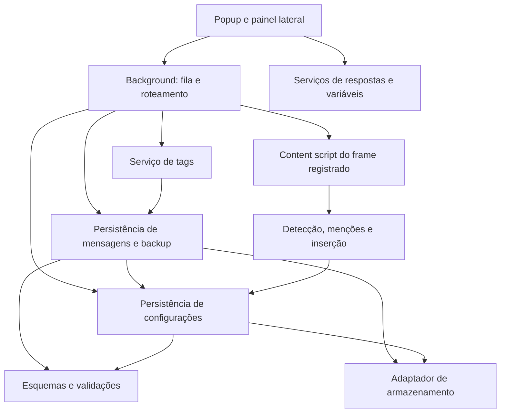

# Arquitetura e pontos de extensão

O projeto mantém WXT, Vue 3 e TypeScript. As funções de respostas e licenças executam na extensão; a integração opcional de IA chama APIs diretamente no background da extensão, sem programas externos. A estrutura é organizada por domínio: pontos de entrada enxutos em `entrypoints/`, componentes Vue modulares em `components/`, composables em `composables/`, serviços e regras em `services/`, contratos em `types/` e documentação em `docs/`.

## Responsabilidades

| Camada | Arquivos | Responsabilidade |
| --- | --- | --- |
| Pontos de entrada | `entrypoints/popup/App.vue`, `entrypoints/content.ts`, `entrypoints/background.ts` | Orquestração enxuta de interface, content script e service worker/background. |
| Componentes de layout & UI | `components/layout/`, `components/templates/`, `components/modals/`, `components/common/ColorSwatchPicker.vue` | Cabeçalho, rodapé, lista, cards, formulário de respostas, seletor de cores compartilhado e modais de confirmação/atualização. |
| Telas de gestão | `components/settings/` (`VariablesView`, `TagsView`, `ShortcutsView`, `TechniciansView`, `AppearanceView`) | Cadastros dedicados de variáveis, tags, atalhos do editor, técnicos das licenças e aparência/tema. |
| Aparência & temas | `services/appearance/` (`appearanceStorage.ts`, `themeTokens.ts`, `inpageTheme.ts`, `browserIcon.ts`, `iconGeometry.ts`) | Paleta claro/escuro/sistema, tokens da marca/cor secundária, contraste de badges, sincronização in-page e ícone dinâmico no navegador. |
| Composables | `composables/useTemplateReorder.ts` | Lógica reativa reutilizável (drag-and-drop e reordenação por teclado). |
| Background | `services/background/` (`storageQueue.ts`, `ticketRouter.ts`) | Fila serializada de gravações e roteamento seguro por aba/frame e token. |
| Modelos e persistência | `services/storage/` (`rawStorage.ts`, `settingsSchema.ts`, `settingsStorage.ts`, `templateTagSchema.ts`, `templateTags.ts`, `templateStorage.ts`) | Adaptação das APIs, contratos, validações, migrações, conflitos e backup. |
| Respostas & modal | `services/templates/` (`templateResolver.ts`, `templateVariables.ts`, `variablePromptModal.ts`, `replyList.ts`) | Resolução de variáveis, modal estilizado de preenchimento e lista compartilhada. |
| Automação Octadesk | `services/octadesk/` (`editorContext.ts`, `ticketWidget.ts`, `licenseDetector.ts`, `licenseRequest.ts`, `mentionHelper.ts`, `insertText.ts`, `replyShortcut.ts`) | Registro de editores, widget flutuante, escopo do ticket, e-mail, menções e atalho no editor. |
| Atualizações | `services/updates/updateChecker.ts` | Consulta oficial de releases no GitHub. |

Os consumidores importam modelos e validadores diretamente dos esquemas e as operações de gravação dos respectivos serviços. Cada símbolo tem uma única exportação, evitando conflitos com a descoberta automática de imports do WXT.

## Direção das dependências

Validações não dependem das telas nem dos serviços de persistência. O adaptador `storage.ts` não importa regras de mensagens ou automação. `settingsStorage.ts` depende apenas do adaptador e do esquema de configurações. `templateStorage.ts` utiliza os esquemas de tags e o serviço de configurações; `templateTags.ts` utiliza a persistência de mensagens para atualizar associações. Essa separação evita os ciclos entre configurações e menções e entre mensagens e catálogo de tags.

## Roteamento e contexto

O editor registra seu token e frame no background. As ações do popup e painel capturam o token antes de iniciar um preenchimento assíncrono e o conferem ao encaminhar a resposta. O background envia a ação somente ao frame registrado; o content script valida o editor e o ticket novamente. Mensagens arbitrárias de `window.postMessage` não inserem texto.

Widgets e atalhos capturam o editor, a identidade do ticket e o rascunho antes de solicitar variáveis. Cancelamento, mudança de ticket ou edição do rascunho durante o preenchimento interrompem a inserção. Iframes acessíveis de mesma origem podem herdar o escopo do ticket que os contém. Iframes sem acesso não são atravessados; não se usa o texto global da página como substituto.

| Mensagem | Uso |
| --- | --- |
| `REGISTER_EDITOR`, `CAPTURE_EDITOR`, `ROUTE_TICKET_ACTION` | Registro, captura e encaminhamento ao editor. |
| `INSERT_REPLY`, `CHECK_LICENSE_TICKET`, `AUTOMATE_LICENSE_MENTIONS` | Ações executadas pelo content script. |
| `TEMPLATE_STORAGE` | Leitura, gravação, importação e exportação de mensagens/backup. |
| `TAG_CATALOG` | Leitura e gravação do catálogo de tags. |
| `SETTINGS_STORAGE` | Leitura e gravação de variáveis, técnicos, atalho e aparência. |
| `SYNC_BROWSER_ICON` | Reaplicação do ícone dinâmico na barra/painel lateral conforme o tema resolvido. |

## Persistência e compatibilidade

Conversas da IA usam uma chave privada `octablaster_ticket_chat_v1_<sha256>` por origem/workspace/ticket. `ticketChatPersistence.ts` gera a identidade estável sem depender de query, hash ou rota de entrada. `aiChatStorage.ts` expõe o repositório modular de `services/storage/history/`, com revisão otimista e transações no IndexedDB `octablaster-history`. Metadados indexados, mensagens individuais, rascunhos e contextos por referência ficam em armazenamentos separados. O menu pagina 30 metadados; a abertura lê 60 mensagens e permite buscar as anteriores. Rascunhos têm debounce de 600 ms e gravação independente. Não há backup no armazenamento da página nem alteração no formato de backup dos templates. O HTML original do atendimento não é arquivado. A restauração não solicita inferência; perguntas subsequentes combinam histórico limitado e contexto atual do ticket.

| Chave | Conteúdo |
| --- | --- |
| `octablaster_quick_replies_v2` | Mensagens, ordem e associações com tags. |
| `octablaster_initialized_v2` | Inicialização da instalação. |
| `octablaster_defaults_state` | Versão da migração e IDs dos padrões já apresentados. |
| `octablaster_tags` | Catálogo de tags com ID, nome e cor opcional (`color`). |
| `octablaster_variables` | Nome, valor e modo de cada variável. |
| `octablaster_mention_targets` | ID, nome, busca, padrão de identificação e estado dos técnicos. |
| `octablaster_shortcut` | `\\`, `/` ou string vazia. |
| `octablaster_appearance` | Tema (`system`, `light`, `dark`), `brandColor` e `logoInnerColor` opcional (cor secundária). |

O background serializa leituras e gravações das três famílias de dados. As funções com sufixo `Local` executam dentro desse contexto e não enviam uma nova mensagem ao próprio background. A interface usa as funções públicas que encaminham as operações.

Os formulários enviam a proposta junto com a cópia carregada anteriormente. A comparação entre base, proposta e estado atual preserva alterações em itens independentes. Alterações incompatíveis no mesmo item rejeitam a gravação. Variáveis usam o nome sem distinção de maiúsculas como chave; técnicos e tags usam IDs. Renomear variável altera sua chave e exige atualizar os tokens das mensagens. O estado de migração evita recriar padrões que o usuário excluiu intencionalmente.

`storage.ts` suporta Promises e callbacks do Chrome, verifica `runtime.lastError` e mantém o fallback em `localStorage` quando disponível. Se o principal e o fallback falharem, a operação rejeita. O fallback só conta como sucesso se concluir todas as chaves. Não há transação entre chaves do `localStorage`: falhas intermediárias podem deixar uma gravação parcial, sempre acompanhada de erro. O service worker do Chrome não possui esse fallback.

O backup no formato 2 contém `format`, `version`, `templates`, `tags` (incluindo `color` opcional) e `settings` (`variables`, `targets`, `trigger` e `appearance` opcional). A exportação lê o estado persistido dentro da fila. Na importação, os dados e conflitos são avaliados antes da gravação conjunta; mensagens e tags são mescladas e configurações são restauradas com proteção contra alterações concorrentes. Listas antigas e backups no formato 1 não modificam as configurações atuais. O arquivo inclui os valores salvos das variáveis em texto legível.

## Licenças e dependência do DOM

`licenseRequest.ts` lê o formulário em `.content-comment-interaction` no ticket atual. O último formulário reconhecido na ordem do DOM prevalece; seus campos não são completados com valores de outro comentário. Citações e editores são excluídos. Banco, quantidade, isenção e códigos vêm dos campos identificados, sem extrair números do título ou CNPJ. A troca exige o motivo.

`mentionHelper.ts` ativa a Anotação Interna e aguarda cada seleção ser confirmada antes da próxima busca, com limite de 15 segundos por técnico entre sugestões e confirmação. No HTML nativo fornecido, a confirmação usa `<person personid="…" class="mentioned">`; a etiqueta precisa ter identificador preenchido. Os técnicos continuam no mesmo parágrafo. O resumo é acrescentado depois e a anotação não é enviada automaticamente. Há reconhecimento de marcadores já presentes e de resumo idêntico em uma nova tentativa.

Sem formulário reconhecido, permanece a marcação de técnicos. Formulário reconhecido com campos obrigatórios inválidos interrompe a preparação antes de alterar o editor. Se o Octadesk mudar a estrutura dos popovers, marcadores ou formulário, confira o HTML real e adapte os seletores com uma fixture de regressão. A ordem do DOM e a representação de citações são limitações conhecidas da extração.

## Como adicionar funcionalidades

- **Nova regra de variável:** altere a validação em `settingsSchema.ts` ou a resolução em `templateVariables.ts`; mantenha valores substituídos literais e preserve o cancelamento.
- **Novo cadastro:** defina contratos e validação, implemente persistência na fila do background, use uma base para detectar conflitos e só então conecte o formulário Vue. Atualize o backup quando o dado precisar ser transportável.
- **Novo canal de respostas:** reutilize `replyList.ts` e `prepareTemplate`; valide novamente o editor após qualquer espera e escreva apenas no rascunho.
- **Novo formulário de licença:** acrescente a leitura em `licenseRequest.ts` com HTML anonimizado e casos de campo ausente, ambiguidade e outro ticket. Preserve os tokens nativos durante a inserção.

Não são necessárias novas dependências, serviços externos ou um framework de arquitetura para essas extensões. Os testes, tipos e builds descritos em [CONTRIBUTING.md](../CONTRIBUTING.md) verificam os contratos entre os módulos.

## IA no painel lateral (1.3.0)

`aiSummaryLifecycle.ts` ancora os controles; `aiPanelBridge.ts` extrai contexto, mantém referências ao ticket/editor e valida snapshots de inserção. `aiTrigger.ts` mostra processamento e erros nos controles da página; o Chrome abre a lateral no background. No Firefox, a lateral aberta recebe o chat; quando fechada, o popup oferece uma ação nativa para abri-la com um gesto autorizado. O iframe de gatilho foi removido. `aiPanelRouter.ts` controla sessões por janela, persistência por ticket, cache limitado, cancelamento e geração via `aiRouter.ts` e `services/ai/api/`. `AiChatPanel.vue` apresenta mensagens e ações de cópia/edição/inserção sem HTML gerado. Os módulos antigos de modal/popover de IA foram removidos.

O modelo recebe autor/papel dos cabeçalhos quando conhecidos. O HTML bruto não é arquivado; persistem mensagens do chat, rascunhos e o contexto extraído em texto e trecho HTML sanitizado do contêiner do ticket para retomada pelo histórico, sob a mesma retenção. Chats independentes usam tarefa general com instruções próprias e chaves aleatórias; tickets preservam sua chave estável. `api/engine.ts` mantém o contexto por conversa; `api/retention.ts` trata expiração/exclusão remota fora da inferência. O transporte autenticado e os adaptadores ficam em `api/transport.ts` e `api/providers/`. As chaves ficam em IndexedDB da origem da extensão, fora dos backups e do storage acessível aos content scripts. `writingMemory.ts` guarda somente estatísticas numéricas de respostas publicadas. Nenhuma automação envia a resposta ao cliente.

`aiReplyGeneration.ts` gera diretamente no editor público: captura a orientação, limpa o campo, conserva a restauração local para erros e revalida identidade/editor/conteúdo antes de preencher. Digitação cancela o resultado pendente; nenhuma conversa lateral é criada. `AI_PANEL_SHOW` reabre um resumo em curso sem reiniciar a inferência.

O contexto da conversa é definido explicitamente na abertura: o ícone/Nova conversa cria um chat sem contexto; somente os botões de resumo associam dados do atendimento. A navegação da página não seleciona outra conversa nem introduz dados de outro ticket. Perguntas no chat usam a chave já associada, sem interpretar números no texto.

O roteador mantém conversas vazias em memória e persiste no primeiro envio. Nova conversa usa uma chave independente, preservando o chat anterior. Reabrir pelo resumo recupera a conversa canônica do ticket; títulos personalizados são metadados locais e não alteram sua identidade.

A configuração e os contratos dos módulos de API estão documentados em [IA por APIs](IA-APIS.md).

### Contexto independente da aba ativa

`aiTicketStore.ts` mantém os metadados do ticket separados do histórico no mesmo IndexedDB, compartilhando textos de contexto pelo hash e contagem de referências. A migração remove cada original de storage.local somente após o commit; o orçamento global é de 50 MB estimados. A limpeza usa índices/lotes de 100 e alarme horário do navegador. `aiRetention.ts` aplica a retenção a ambos. `ai/ticketContext.ts` resolve o contexto da fonte original ou dos dados locais usando a chave vinculada à conversa. Os botões de resumo são a única origem de associação com uma página; o ícone e Nova conversa não leem a aba ativa. A interface é única e não expõe modos separados. A extração automática de números e o registro periódico de tickets da página foram removidos.

### Controles de geração por solicitação

`AiChatComposer.vue` reúne texto, menus de tokens/raciocínio e envio em tema claro. `useAiRequestOptions.ts` guarda escolhas efêmeras e captura opções/revisão para o próximo envio. A configuração da conexão não contém mais tokens. `requestOptions.ts` valida a mensagem pública e `api/reasoning.ts` traduz somente escolhas compatíveis, sem desligamento automático por nome. O motor verifica a revisão ativa, separa teto de saída e orçamento de raciocínio e inclui a política no fingerprint remoto. Parâmetros não são gravados nos chats e não alteram o contexto vinculado ao ticket.
